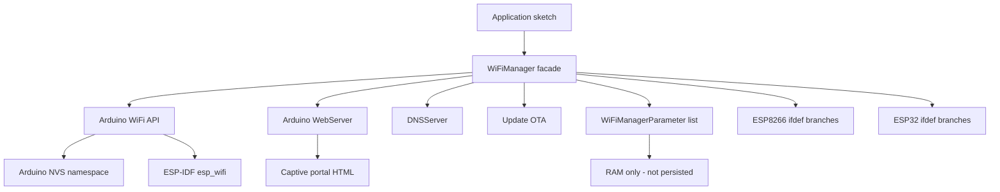

# WiFiManager Library Assessment

**Assessment date:** 2026-10-26
**Repository:** `WiFiManager_ESP32`
**Library version assessed:** 2.0.17
**Target baseline for remediation:** ESP32 only, Arduino-ESP32 3.x, ESP-IDF 5.x
**Deliverable type:** Assessment and prioritized remediation backlog only. No source code was modified.

---

## 1. Executive summary

The library is a mature, feature-rich captive-portal WiFi manager, but it is architecturally anchored to the ESP8266/ESP32 Arduino cores of the 2019-2021 era. It is a single 4,054-line translation unit with ESP8266 and ESP32 code paths interleaved through `#ifdef` blocks, no platform abstraction layer, and no ownership of persistent configuration.

The user's premise is confirmed:

- **ESP8266 logic is pervasive.** It is not isolated to a few files. It appears in the public header, the implementation, the constants headers, the strings headers, the packaging metadata, and the CI matrix.
- **The library does not use ESP-IDF `Preferences`.** There is no `Preferences` include or usage anywhere. WiFi credentials are stored by the Arduino WiFi stack in its own NVS namespace. Custom `WiFiManagerParameter` values are **not persisted at all**; the application must save them in a callback.
- **Persistence is controlled by toggling `WiFi.persistent()`** around operations. This is fragile, deprecated on newer cores, and can cause unintended writes or lost writes.
- **`erase(true)` calls `nvs_flash_erase()`**, which wipes the entire NVS partition, not just WiFiManager data. This can destroy application settings, BLE bonds, and other subsystem state.
- **The code is not ready for Arduino-ESP32 3.x / ESP-IDF 5.x.** Several APIs used are deprecated, removed, or have changed signatures. The version-detection macros are also logically broken because they use `#ifdef` on macros that are always defined as expressions.

The library's strengths should be preserved: the captive portal UX, non-blocking mode, callback surface, custom parameters, i18n string packs, OTA page, and debug levels are all valuable. The remediation backlog below is ordered to protect those strengths while removing the ESP8266 legacy and modernizing persistence and platform integration.

### Severity legend

| Severity | Meaning |
|---|---|
| Critical | Data loss, security exposure, or blocks modernization |
| High | Correctness, stability, or compatibility risk on the target baseline |
| Medium | Maintainability, memory safety, or operational risk |
| Low | Code quality, documentation, or developer experience |

---

## 2. Architecture snapshot

Key structural observations:

- [`WiFiManager.h`](WiFiManager.h:258) declares one large facade class with public, protected, and internal state mixed together.
- [`WiFiManager.cpp`](WiFiManager.cpp:1) contains parameter management, portal lifecycle, HTTP handlers, HTML generation, persistence, OTA, platform shims, and debug output in one file.
- There is no `StorageBackend`, `WifiBackend`, or `WebBackend` abstraction. Platform differences are handled inline with `#ifdef`.
- The public API leaks internals such as [`_preloadwifiscan`](WiFiManager.h:643), [`_scancachetime`](WiFiManager.h:644), and [`_asyncScan`](WiFiManager.h:645).

---

## 3. Detailed findings

### 3.1 Platform coupling and ESP8266 legacy

#### F-01 — ESP8266 code is interleaved throughout the library (High)

**Evidence**

- Public header includes ESP8266-only headers and macros: [`WiFiManager.h:68`](WiFiManager.h:68) through [`WiFiManager.h:81`](WiFiManager.h:81), including `user_interface.h`, `ESP8266WiFi.h`, `ESP8266WebServer.h`, `ESP.getChipId()`, and `ENC_TYPE_NONE`.
- ESP8266 branches in the implementation include [`WiFiManager.cpp:253`](WiFiManager.cpp:253), [`WiFiManager.cpp:330`](WiFiManager.cpp:330), [`WiFiManager.cpp:405`](WiFiManager.cpp:405), [`WiFiManager.cpp:470`](WiFiManager.cpp:470), [`WiFiManager.cpp:831`](WiFiManager.cpp:831), [`WiFiManager.cpp:1196`](WiFiManager.cpp:1196), [`WiFiManager.cpp:1264`](WiFiManager.cpp:1264), [`WiFiManager.cpp:1516`](WiFiManager.cpp:1516), [`WiFiManager.cpp:2002`](WiFiManager.cpp:2002), [`WiFiManager.cpp:2133`](WiFiManager.cpp:2133), [`WiFiManager.cpp:2144`](WiFiManager.cpp:2144), [`WiFiManager.cpp:2153`](WiFiManager.cpp:2153), [`WiFiManager.cpp:2158`](WiFiManager.cpp:2158), [`WiFiManager.cpp:2183`](WiFiManager.cpp:2183), [`WiFiManager.cpp:2230`](WiFiManager.cpp:2230), [`WiFiManager.cpp:2282`](WiFiManager.cpp:2282), [`WiFiManager.cpp:2620`](WiFiManager.cpp:2620), [`WiFiManager.cpp:3426`](WiFiManager.cpp:3426), [`WiFiManager.cpp:3467`](WiFiManager.cpp:3467), [`WiFiManager.cpp:3643`](WiFiManager.cpp:3643), [`WiFiManager.cpp:3663`](WiFiManager.cpp:3663), [`WiFiManager.cpp:3685`](WiFiManager.cpp:3685), [`WiFiManager.cpp:3710`](WiFiManager.cpp:3710), [`WiFiManager.cpp:3748`](WiFiManager.cpp:3748), [`WiFiManager.cpp:3776`](WiFiManager.cpp:3776), [`WiFiManager.cpp:3788`](WiFiManager.cpp:3788), [`WiFiManager.cpp:3821`](WiFiManager.cpp:3821), [`WiFiManager.cpp:3893`](WiFiManager.cpp:3893), and [`WiFiManager.cpp:3958`](WiFiManager.cpp:3958).
- ESP8266-specific constants and country structs: [`wm_consts_en.h:138`](wm_consts_en.h:138) through [`wm_consts_en.h:178`](wm_consts_en.h:178).
- ESP8266-specific SSID prefix: [`wm_strings_en.h:271`](wm_strings_en.h:271) through [`wm_strings_en.h:277`](wm_strings_en.h:277).
- Packaging still advertises ESP8266: [`library.json:24`](library.json:24) through [`library.json:28`](library.json:28), and [`library.properties:9`](library.properties:9).

**Impact**

Removing ESP8266 support is not a small deletion. It requires touching the header, implementation, constants, strings, packaging, examples, and CI. Until that is done, every modernization change must be validated against two platforms, which slows progress and keeps dead code in the build.

**Remediation direction**

Introduce a platform abstraction layer first, then delete ESP8266 branches. Do not attempt a blind find-and-delete; several ESP8266 branches contain behavior that must be re-expressed with ESP-IDF APIs on ESP32.

#### F-02 — ESP8266-only APIs are used directly in the platform shims (High)

**Evidence**

- [`WiFi_Mode()`](WiFiManager.cpp:3661) uses `wifi_get_opmode()`, `wifi_set_opmode()`, `wifi_set_opmode_current()`, and `ETS_UART_INTR_DISABLE()`.
- [`WiFi_Disconnect()`](WiFiManager.cpp:3684) uses `wifi_station_disconnect()`.
- [`WiFi_eraseConfig()`](WiFiManager.cpp:3743) uses `ESP.eraseConfig()` and raw flash sector erasure.
- [`WiFi_SSID()`](WiFiManager.cpp:3788) and [`WiFi_psk()`](WiFiManager.cpp:3821) use `struct station_config` and `wifi_station_get_config_default()`.
- [`WiFi_softap_num_stations()`](WiFiManager.cpp:3776) uses `wifi_softap_get_station_num()`.
- [`WiFi_autoReconnect()`](WiFiManager.cpp:3893) uses `WiFi.setAutoReconnect()`.
- [`debugSoftAPConfig()`](WiFiManager.cpp:3424) uses `softap_config` and `wifi_softap_get_config()`.
- [`debugPlatformInfo()`](WiFiManager.cpp:3466) uses `system_print_meminfo()`.
- WPS uses `WiFi.beginWPSConfig()` at [`WiFiManager.cpp:1264`](WiFiManager.cpp:1264).
- OTA uses `WiFiUDP::stopAll()` at [`WiFiManager.cpp:3958`](WiFiManager.cpp:3958).

**Impact**

These are the concrete blockers to an ESP32-only build. They also hide the fact that the ESP32 paths are themselves using legacy IDF APIs.

#### F-03 — The `WM_WEBSERVERSHIM` fallback is broken (Low)

**Evidence**

[`WiFiManager.h:64`](WiFiManager.h:64) always defines `WM_WEBSERVERSHIM`. The `#else` branch at [`WiFiManager.h:95`](WiFiManager.h:95) includes `ESP8266WebServer.h` on ESP32, which is not a valid ESP32 header. The branch is effectively dead but misleading.

**Impact**

Confusing configuration surface. It should be removed when ESP8266 support is removed.

---

### 3.2 Persistence and NVS

#### F-04 — No use of ESP-IDF `Preferences` (Critical)

**Evidence**

A repository-wide search for `Preferences`, `nvs_open`, `nvs_set`, and `nvs_get` found no library usage. The only NVS code is the destructive `nvs_flash_erase()` path at [`WiFiManager.cpp:2603`](WiFiManager.cpp:2603).

**Impact**

The library does not own its configuration. Credentials live in the Arduino WiFi stack's NVS namespace. Custom parameters live only in RAM. This makes behavior dependent on the Arduino core's internal storage layout and prevents clean migration, versioning, or scoped erasure.

#### F-05 — Custom parameters are never persisted (Critical)

**Evidence**

[`doParamSave()`](WiFiManager.cpp:1941) reads submitted values and writes them into the in-memory `_value` buffers at [`WiFiManager.cpp:1971`](WiFiManager.cpp:1971). It then invokes `_saveparamscallback`. There is no storage write.

**Impact**

Every application must implement its own persistence in the callback. This is the single largest functional gap versus a modern WiFi manager. It also means `resetSettings()` and `erase()` do not clear custom parameters, because the library does not know about them.

#### F-06 — `erase(true)` wipes the entire NVS partition (Critical)

**Evidence**

[`WiFiManager::erase(bool opt)`](WiFiManager.cpp:2598) calls `nvs_flash_init()` and `nvs_flash_erase()` at [`WiFiManager.cpp:2610`](WiFiManager.cpp:2610) and [`WiFiManager.cpp:2614`](WiFiManager.cpp:2614).

**Impact**

This destroys all NVS data, not just WiFiManager data. On a device that stores application settings, calibration, BLE bonds, or provisioning data in NVS, this is a data-loss bug. It is also exposed through the web UI via [`handleErase()`](WiFiManager.cpp:2378).

#### F-07 — `WiFi.persistent()` toggling is fragile and deprecated (High)

**Evidence**

- [`_begin()`](WiFiManager.cpp:248) disables persistence on non-ESP32 at [`WiFiManager.cpp:253`](WiFiManager.cpp:253).
- [`_end()`](WiFiManager.cpp:258) re-enables it at [`WiFiManager.cpp:260`](WiFiManager.cpp:260).
- [`wifiConnectNew()`](WiFiManager.cpp:1104) toggles it around `WiFi.begin()` at [`WiFiManager.cpp:1112`](WiFiManager.cpp:1112) and [`WiFiManager.cpp:1114`](WiFiManager.cpp:1114).
- [`WiFi_Mode()`](WiFiManager.cpp:3661) toggles it at [`WiFiManager.cpp:3673`](WiFiManager.cpp:3673) and [`WiFiManager.cpp:3675`](WiFiManager.cpp:3675).
- [`WiFi_enableSTA()`](WiFiManager.cpp:3706) toggles it at [`WiFiManager.cpp:3732`](WiFiManager.cpp:3732) and [`WiFiManager.cpp:3734`](WiFiManager.cpp:3734).
- [`WiFi_eraseConfig()`](WiFiManager.cpp:3743) toggles it at [`WiFiManager.cpp:3768`](WiFiManager.cpp:3768) and [`WiFiManager.cpp:3771`](WiFiManager.cpp:3771).
- [`resetSettings()`](WiFiManager.cpp:2653) toggles it at [`WiFiManager.cpp:2666`](WiFiManager.cpp:2666) and [`WiFiManager.cpp:2668`](WiFiManager.cpp:2668).

**Impact**

`WiFi.persistent()` is a global, process-wide switch with no getter on older cores. Toggling it around asynchronous WiFi operations is inherently racy. On newer Arduino-ESP32 cores the API is deprecated or removed. The library also cannot reliably restore the user's original setting.

#### F-08 — `getWiFiIsSaved()` is bypassed by a hardcoded workaround (Medium)

**Evidence**

[`autoConnect()`](WiFiManager.cpp:278) sets `bool wifiIsSaved = true;` at [`WiFiManager.cpp:284`](WiFiManager.cpp:284) with the comment "workaround until I can check esp32 wifiisinit and has nvs". The real helper [`getWiFiIsSaved()`](WiFiManager.cpp:3285) exists but is not used there.

**Impact**

The library always attempts a connection even when no credentials are saved, adding startup latency and log noise. A Preferences-backed store would make this check reliable.

#### F-09 — No schema versioning or migration path (High)

**Evidence**

There is no namespace, key naming convention, version key, or migration code anywhere in the library.

**Impact**

Any future change to stored keys or formats will require application-level migration. A modern storage layer should include a schema version and a migration hook from the Arduino WiFi NVS namespace.

---

### 3.3 ESP-IDF 5.x and Arduino-ESP32 3.x compatibility

#### F-10 — Version-detection macros are logically broken (High)

**Evidence**

[`WiFiManager.h:736`](WiFiManager.h:736) through [`WiFiManager.h:754`](WiFiManager.h:754):

- `WM_ARDUINOVERCHECK` is defined as an expression, then tested with `#ifdef WM_ARDUINOVERCHECK`. Because it is always defined, the `#else` branch that defines `WM_NOSOFTAPSSID` and `WM_NOCOUNTRY` is dead.
- `WM_ARDUINOVERCHECK_204` is also defined as an expression and tested with `#ifdef`, so `WM_DISCONWORKAROUND` is always defined whenever `ESP_ARDUINO_VERSION` exists.
- `#ifdef VER_ARDUINO_STR` at [`WiFiManager.cpp:2305`](WiFiManager.cpp:2305) is always true because `VER_ARDUINO_STR` is always defined, even as `"Unknown"`.
- `#ifdef WM_DEBUG_LEVEL` is always true because a default is defined at [`WiFiManager.h:816`](WiFiManager.h:816).

**Impact**

Feature gating does not reflect the actual core version. This is a latent source of build and runtime differences across Arduino-ESP32 2.x and 3.x.

#### F-11 — Legacy ESP32 event API usage (High)

**Evidence**

[`WiFiEvent()`](WiFiManager.cpp:3844) is declared with two signatures:

- `arduino_event_info_t` when `WM_ARDUINOEVENTS` is defined.
- `system_event_info_t` otherwise.

The `system_event_info_t` type is legacy and removed in newer IDF versions. The event constants are also aliased manually at [`WiFiManager.cpp:3849`](WiFiManager.cpp:3849) through [`WiFiManager.cpp:3851`](WiFiManager.cpp:3851).

**Impact**

The event handler is a likely build break on Arduino-ESP32 3.x. The signature, event enum names, and `WiFi.onEvent` return type must be verified against the target core.

#### F-12 — Legacy IDF WiFi configuration APIs (High)

**Evidence**

- `esp_wifi_get_config()` at [`WiFiManager.cpp:3805`](WiFiManager.cpp:3805), [`WiFiManager.cpp:3839`](WiFiManager.cpp:3839), and [`WiFiManager.cpp:3436`](WiFiManager.cpp:3436).
- `WiFiGenericClass::getMode()` at [`WiFiManager.cpp:3809`](WiFiManager.cpp:3809) and [`WiFiManager.cpp:3835`](WiFiManager.cpp:3835).
- `esp_wifi_set_country_code()` at [`WiFiManager.cpp:3628`](WiFiManager.cpp:3628).
- `CONFIG_ESP32_PHY_MAX_WIFI_TX_POWER` in [`wm_consts_en.h:165`](wm_consts_en.h:165) through [`wm_consts_en.h:167`](wm_consts_en.h:167).

**Impact**

Some of these remain valid in IDF 5.x, but several are deprecated or renamed. `CONFIG_ESP32_PHY_MAX_WIFI_TX_POWER` in particular is an IDF 4.x-era symbol and may not exist under the same name in IDF 5.x. These must be verified and replaced with the current `esp_wifi` and `esp_netif` APIs.

#### F-13 — Arduino WiFi API signatures changed across 2.x and 3.x (High)

**Evidence**

The library uses APIs whose signatures or availability differ across cores:

- `WiFi.persistent()` at multiple sites.
- `WiFi.enableSTA()` at [`WiFiManager.cpp:3733`](WiFiManager.cpp:3733).
- `WiFi.disconnect(bool, bool)` at [`WiFiManager.cpp:2664`](WiFiManager.cpp:2664) and [`WiFiManager.cpp:3769`](WiFiManager.cpp:3769).
- `WiFi.begin(ssid, pass, channel, bssid, connect)` at [`WiFiManager.cpp:1113`](WiFiManager.cpp:1113).
- `WiFi.onEvent()` at [`WiFiManager.cpp:3903`](WiFiManager.cpp:3903).
- `WiFi.removeEvent()` at [`WiFiManager.cpp:240`](WiFiManager.cpp:240).
- `WiFi.softAPSSID()` at [`WiFiManager.cpp:2233`](WiFiManager.cpp:2233).
- `WiFi.hostname()` versus `WiFi.getHostname()` at [`WiFiManager.cpp:2271`](WiFiManager.cpp:2271) and [`WiFiManager.cpp:3172`](WiFiManager.cpp:3172).
- `temperatureRead()` at [`WiFiManager.cpp:2292`](WiFiManager.cpp:2292).
- `Update.errorString()` at [`WiFiManager.cpp:4033`](WiFiManager.cpp:4033).

**Impact**

A compile matrix against Arduino-ESP32 3.x is required before any refactor. The assessment cannot certify these as compatible without building against the target core.

#### F-14 — `rom/rtc.h` include paths are version- and target-specific (Medium)

**Evidence**

[`WiFiManager.h:111`](WiFiManager.h:111) through [`WiFiManager.h:127`](WiFiManager.h:127) select `esp32/rom/rtc.h`, `esp32s2/rom/rtc.h`, `esp32c3/rom/rtc.h`, or `esp32s3/rom/rtc.h` based on `CONFIG_IDF_TARGET_*`.

**Impact**

The list is incomplete for newer targets such as C6, H2, and P4. The include path layout also changed in IDF 5.x. This should be replaced with the public `esp_system` reset-reason API.

---

### 3.4 Blocking behavior, timing, and concurrency

#### F-15 — Blocking loops and fixed delays are pervasive (High)

**Evidence**

- Blocking config portal loop at [`WiFiManager.cpp:784`](WiFiManager.cpp:784) through [`WiFiManager.cpp:816`](WiFiManager.cpp:816).
- Connect wait loop with `delay(100)` at [`WiFiManager.cpp:1244`](WiFiManager.cpp:1244) through [`WiFiManager.cpp:1254`](WiFiManager.cpp:1254).
- Scan wait loop with `delay(100)` at [`WiFiManager.cpp:1548`](WiFiManager.cpp:1548) through [`WiFiManager.cpp:1553`](WiFiManager.cpp:1553).
- Fixed delays at [`WiFiManager.cpp:457`](WiFiManager.cpp:457), [`WiFiManager.cpp:531`](WiFiManager.cpp:531), [`WiFiManager.cpp:880`](WiFiManager.cpp:880), [`WiFiManager.cpp:997`](WiFiManager.cpp:997), [`WiFiManager.cpp:1039`](WiFiManager.cpp:1039), [`WiFiManager.cpp:1135`](WiFiManager.cpp:1135), [`WiFiManager.cpp:2346`](WiFiManager.cpp:2346), [`WiFiManager.cpp:2367`](WiFiManager.cpp:2367), [`WiFiManager.cpp:2399`](WiFiManager.cpp:2399), and [`WiFiManager.cpp:4047`](WiFiManager.cpp:4047).

**Impact**

The blocking portal is acceptable for simple sketches, but the fixed delays and busy-waits are fragile. They can trip the task watchdog, delay OTA, and make the non-blocking mode less responsive than it appears. There is no `esp_timer`, FreeRTOS task, or event-driven state machine.

#### F-16 — `yield()` is the only cooperative scheduling mechanism (Medium)

**Evidence**

[`WiFiManager.cpp:815`](WiFiManager.cpp:815) calls `yield()` in the blocking portal loop. Other long operations rely on `delay(0)` sprinkled through HTML generation and menu setup.

**Impact**

On ESP32, `yield()` is not a substitute for a proper event loop or task. Long HTML generation and scan sorting can still starve other tasks.

---

### 3.5 Web server, captive portal, and OTA

#### F-17 — Web server lifecycle is unsafe (Medium)

**Evidence**

[`setupHTTPServer()`](WiFiManager.cpp:618) does `server.reset(new WM_WebServer(_httpPort))` at [`WiFiManager.cpp:630`](WiFiManager.cpp:630). The adjacent comment explicitly says this is not the safest way to reset the server and can crash callbacks initialized before it. [`shutdownConfigPortal()`](WiFiManager.cpp:957) calls `server->stop()` and `server.reset()` at [`WiFiManager.cpp:974`](WiFiManager.cpp:974) and [`WiFiManager.cpp:975`](WiFiManager.cpp:975).

**Impact**

Repeated portal start/stop cycles can leave dangling callbacks or port conflicts. The comment at [`WiFiManager.cpp:972`](WiFiManager.cpp:972) acknowledges open issues about the port not clearing.

#### F-18 — Captive portal detection is minimal (Medium)

**Evidence**

[`captivePortal()`](WiFiManager.cpp:2440) compares the `Host` header to the server's local IP and redirects if they differ. It does not handle OS-specific connectivity probes, DHCP option 114, or RFC 8910.

**Impact**

Modern phones and laptops may not present the captive portal prompt reliably. The library also notes that captive portals hammer the root page, causing repeated scans at [`WiFiManager.cpp:1362`](WiFiManager.cpp:1362) through [`WiFiManager.cpp:1364`](WiFiManager.cpp:1364).

#### F-19 — OTA and portal are unauthenticated (High)

**Evidence**

- Authentication code is present but disabled: [`WiFiManager.cpp:1328`](WiFiManager.cpp:1328) sets `bool testauth = false;` and returns immediately.
- OTA upload is handled by [`handleUpdating()`](WiFiManager.cpp:3928) and [`handleUpdateDone()`](WiFiManager.cpp:4020) with no authentication, CSRF token, or firmware signature check.
- The AP password is optional and defaults to empty at [`WiFiManager.h:555`](WiFiManager.h:555). [`startAP()`](WiFiManager.cpp:464) starts an open AP when the password is empty at [`WiFiManager.cpp:515`](WiFiManager.cpp:515) through [`WiFiManager.cpp:525`](WiFiManager.cpp:525).

**Impact**

Anyone within radio range can open the portal, submit credentials, or upload firmware. This is a significant security exposure for a provisioning library.

#### F-20 — Credentials are written to debug logs (Medium)

**Evidence**

- Password logged at [`WiFiManager.cpp:1109`](WiFiManager.cpp:1109) and [`WiFiManager.cpp:1131`](WiFiManager.cpp:1131).
- AP password logged at [`WiFiManager.cpp:3539`](WiFiManager.cpp:3539).
- Request arguments, including submitted credentials, logged at [`WiFiManager.cpp:1841`](WiFiManager.cpp:1841) through [`WiFiManager.cpp:1853`](WiFiManager.cpp:1853).

**Impact**

Serial logs and support dumps can leak WiFi credentials. Debug output should redact secrets by default.

#### F-21 — HTML injection risk in custom parameter values (Medium)

**Evidence**

[`getParamOut()`](WiFiManager.cpp:1730) inserts `_params[i]->getValue()` directly into the `value='{v}'` attribute at [`WiFiManager.cpp:1793`](WiFiManager.cpp:1793) without HTML escaping. [`htmlEntities()`](WiFiManager.cpp:3551) escapes `&`, `<`, `>`, and `'`, but it is not applied to parameter values.

**Impact**

A parameter value containing a single quote can break out of the attribute and inject markup or script. This is especially relevant if parameter values are populated from external data.

#### F-22 — Hardcoded menu indices are fragile (Low)

**Evidence**

[`handleInfo()`](WiFiManager.cpp:1990) appends `HTTP_PORTAL_MENU[8]` and `HTTP_PORTAL_MENU[9]` at [`WiFiManager.cpp:2083`](WiFiManager.cpp:2083) and [`WiFiManager.cpp:2084`](WiFiManager.cpp:2084).

**Impact**

Reordering the menu array silently changes the info page buttons. This should use named indices or tokens.

---

### 3.6 Memory safety and resource management

#### F-23 — Variable-length array in scan rendering (Medium)

**Evidence**

[`getScanItemOut()`](WiFiManager.cpp:1571) declares `int indices[n];` at [`WiFiManager.cpp:1589`](WiFiManager.cpp:1589), where `n` is the number of scanned networks.

**Impact**

VLAs are not standard C++ and can overflow the stack when many APs are visible. This is a real crash risk in dense RF environments.

#### F-24 — `WM_G` macro returns a pointer to a temporary (Medium)

**Evidence**

[`WiFiManager.h:66`](WiFiManager.h:66) defines `WM_G(string_literal)` as `(String(FPSTR(string_literal)).c_str())`. It is used in route registration at [`WiFiManager.cpp:644`](WiFiManager.cpp:644) through [`WiFiManager.cpp:659`](WiFiManager.cpp:659).

**Impact**

The `String` temporary is destroyed at the end of the full expression. If the web server does not copy the URI immediately, the pointer dangles. This is a latent use-after-free.

#### F-25 — `WiFiManagerParameter` has unsafe copy semantics and a non-virtual destructor (Medium)

**Evidence**

- The class has a virtual method [`getCustomHTML()`](WiFiManager.h:230) but a non-virtual destructor at [`WiFiManager.h:221`](WiFiManager.h:221).
- Copy assignment is private at [`WiFiManager.h:236`](WiFiManager.h:236), but the copy constructor is not deleted. The implicitly generated copy constructor copies the raw `_value` pointer, leading to a double free.
- `_id`, `_label`, and `_customHTML` are raw `const char*` pointing to caller-owned memory at [`WiFiManager.h:237`](WiFiManager.h:237) through [`WiFiManager.h:243`](WiFiManager.h:243).

**Impact**

Copying a parameter, or deleting a derived parameter through a base pointer, is undefined behavior. The lifetime of the ID, label, and custom HTML is the caller's responsibility and is not documented.

#### F-26 — Raw `malloc`/`realloc` parameter array (Low)

**Evidence**

[`addParameter()`](WiFiManager.cpp:133) uses `malloc` at [`WiFiManager.cpp:152`](WiFiManager.cpp:152) and `realloc` at [`WiFiManager.cpp:162`](WiFiManager.cpp:162). The destructor frees the array at [`WiFiManager.cpp:233`](WiFiManager.cpp:233) but does not delete the parameter objects.

**Impact**

The ownership model is unclear: the manager owns the array, but not the parameters. This is workable but should be documented or replaced with `std::vector<std::unique_ptr<...>>`.

#### F-27 — Heavy `String` concatenation for HTML (Medium)

**Evidence**

Page generation uses repeated `String` concatenation and `replace()` throughout [`getHTTPHead()`](WiFiManager.cpp:1275), [`getScanItemOut()`](WiFiManager.cpp:1571), [`getParamOut()`](WiFiManager.cpp:1730), and the handlers.

**Impact**

Heap fragmentation and peak memory usage are hard to bound. On ESP32 this is less severe than on ESP8266, but it is still a maintainability and reliability concern.

#### F-28 — Stack-allocated info ID arrays (Low)

**Evidence**

[`handleInfo()`](WiFiManager.cpp:1990) builds `String infoids[]` on the stack at [`WiFiManager.cpp:2004`](WiFiManager.cpp:2004) and [`WiFiManager.cpp:2038`](WiFiManager.cpp:2038).

**Impact**

Minor stack pressure. It also duplicates the list of info fields in two places.

---

### 3.7 Build system, packaging, and CI

#### F-29 — CMake is an Arduino shim, not a native IDF component (Medium)

**Evidence**

[`CMakeLists.txt:3`](CMakeLists.txt:3) through [`CMakeLists.txt:7`](CMakeLists.txt:7) registers the component with `PRIV_REQUIRES arduino` only. There is no `REQUIRES` for `nvs_flash`, `esp_wifi`, `esp_netif`, `esp_http_server`, `mdns`, or `app_update`. There is no `idf_component.yml` and no `Kconfig`.

**Impact**

The library cannot be consumed as a first-class ESP-IDF component. Dependencies are implicit and resolved through the Arduino component, which defeats the purpose of an IDF 5.x modernization.

#### F-30 — Packaging metadata is stale (Medium)

**Evidence**

- [`library.json:2`](library.json:2) declares version `2.0.17`.
- [`library.json:23`](library.json:23) declares `"frameworks": "arduino"`.
- [`library.json:24`](library.json:24) through [`library.json:28`](library.json:28) list `espressif8266` and `espressif32`.
- [`library.properties:2`](library.properties:2) declares version `2.0.17`.
- [`library.properties:9`](library.properties:9) declares `architectures=esp8266,esp32`.

**Impact**

Package managers will continue to offer the library for ESP8266 and will not express the new platform baseline. Versioning is also inconsistent with the header's `@version 0.0.0` at [`WiFiManager.h:9`](WiFiManager.h:9).

#### F-31 — CI is stale and partially broken (High)

**Evidence**

- [`.travis.yml:8`](.travis.yml:8) downloads Arduino 1.8.10. [`.travis.yml:17`](.travis.yml:17) and [`.travis.yml:20`](.travis.yml:20) install unpinned ESP8266 and ESP32 cores.
- [`.github/workflows/compile_library.yml:22`](.github/workflows/compile_library.yml:22) through [`.github/workflows/compile_library.yml:24`](.github/workflows/compile_library.yml:24) build only `nodemcuv2` and `lolin32`.
- [`.github/workflows/compile_library.yml:27`](.github/workflows/compile_library.yml:27), [`.github/workflows/compile_library.yml:29`](.github/workflows/compile_library.yml:29), and [`.github/workflows/compile_library.yml:45`](.github/workflows/compile_library.yml:45) use `actions/checkout@v2`, `actions/cache@v2`, and `actions/setup-python@v2`, which are deprecated.
- [`.github/workflows/compile_examples.yaml:20`](.github/workflows/compile_examples.yaml:20) through [`.github/workflows/compile_examples.yaml:34`](.github/workflows/compile_examples.yaml:34) and [`.github/workflows/compile_examples.yaml:80`](.github/workflows/compile_examples.yaml:80) through [`.github/workflows/compile_examples.yaml:94`](.github/workflows/compile_examples.yaml:94) reference examples that do not exist in this repository, such as `examples/Parameters/SPIFFS/...`, `examples/Super/...`, `examples/Old_examples/...`, `examples/OnDemand/...`, and `examples/ParamsChildClass/...`.
- [`.github/workflows/cpp_lint.yml:16`](.github/workflows/cpp_lint.yml:16) uses `reviewdog/action-cpplint@master`, an unpinned moving target.

**Impact**

CI does not prove compatibility with the target baseline. The example matrix is guaranteed to fail or silently skip missing files. There is no ESP32-S2/S3/C3/C6 matrix, no Arduino-ESP32 3.x matrix, and no IDF 5.x build.

#### F-32 — No tests of any kind (High)

**Evidence**

There are no unit tests, host tests, integration tests, or hardware-in-the-loop tests in the repository. CI only compiles.

**Impact**

Persistence, migration, portal lifecycle, and captive portal behavior cannot be validated automatically. A modernization effort without tests will be high-risk.

---

### 3.8 API design and maintainability

#### F-33 — Monolithic translation unit (Medium)

**Evidence**

[`WiFiManager.cpp`](WiFiManager.cpp:1) is 4,054 lines. It mixes parameter management, portal lifecycle, HTTP handlers, HTML generation, persistence, OTA, platform shims, and debug output.

**Impact**

Hard to navigate, review, test, and reason about. Any change has a large blast radius.

#### F-34 — Public API leaks internals and uses inconsistent conventions (Low)

**Evidence**

- Public scan tuning fields at [`WiFiManager.h:642`](WiFiManager.h:642) through [`WiFiManager.h:645`](WiFiManager.h:645).
- `boolean` instead of `bool` throughout the header, for example [`WiFiManager.h:267`](WiFiManager.h:267).
- Deprecated aliases such as [`setTimeout()`](WiFiManager.h:345) and [`getPlaceholder()`](WiFiManager.h:227).
- Mixed naming conventions: `WiFi_SSID`, `_begin`, `getHTTPHead`, `doParamSave`.
- No namespace; the library pollutes the global namespace with many `const char` symbols in the constants headers.

**Impact**

The API is harder to learn and evolve. A namespace and a smaller public surface would improve usability.

#### F-35 — Error handling is status-code based and kludged (Low)

**Evidence**

- `WL_STATION_WRONG_PASSWORD` is defined as a local kludge at [`WiFiManager.h:589`](WiFiManager.h:589) through [`WiFiManager.h:591`](WiFiManager.h:591).
- `_lastconxresulttmp` is a static shared across instances at [`WiFiManager.h:586`](WiFiManager.h:586) and [`WiFiManager.cpp:18`](WiFiManager.cpp:18).
- Callbacks return `void`, so failures cannot be propagated.

**Impact**

Multi-instance use is unsafe, and callers cannot distinguish failure causes cleanly.

#### F-36 — Redundant qualification and dead code (Low)

**Evidence**

- [`WiFiManager.cpp:1571`](WiFiManager.cpp:1571) defines `String WiFiManager::WiFiManager::getScanItemOut()`, with a redundant `WiFiManager::` qualifier.
- [`getInfoData("aboutidfver")`](WiFiManager.cpp:2078) is called, but the `aboutidfver` branch is commented out at [`WiFiManager.cpp:2310`](WiFiManager.cpp:2310) through [`WiFiManager.cpp:2315`](WiFiManager.cpp:2315). The implemented branch is `aboutsdkver` at [`WiFiManager.cpp:2316`](WiFiManager.cpp:2316), which is never called.
- `HTTP_PORTAL_OPTIONS` is an empty string in the strings headers, for example [`wm_strings_en.h:59`](wm_strings_en.h:59).

**Impact**

Dead code and confusing identifiers increase maintenance cost.

#### F-37 — Documentation is explicitly out of date (Low)

**Evidence**

[`README.md:6`](README.md:6) states "This Documentation is out of date". The README still advertises ESP8266 at [`README.md:19`](README.md:19) and [`README.md:33`](README.md:33). There is no migration guide, no API reference, and no mention of `Preferences`.

**Impact**

Users cannot discover the modern persistence model or the ESP32-only baseline.

---

## 4. What the library does well

These strengths should be preserved during remediation:

- Captive portal UX with DNS redirection and a configurable menu.
- Non-blocking portal mode with `process()`.
- Rich callback surface for AP start, web server start, save, pre-save, reset, OTA, and timeout.
- Custom parameter support with label placement and custom HTML.
- i18n string packs for English, German, Spanish, French, Portuguese, and Brazilian Portuguese.
- OTA firmware upload page.
- Debug levels and platform info page.
- Static IP and DNS configuration.
- Hostname and country configuration.
- Scan caching and optional async scan.

---

## 5. Prioritized remediation backlog

The backlog is ordered by risk and dependency. It is a backlog, not an implementation plan. Each item has acceptance criteria so it can be executed and verified independently.

### P0 — Must fix before modernization

| ID | Item | Evidence | Acceptance criteria |
|---|---|---|---|
| WM-01 | Introduce a `Preferences`-backed storage layer for credentials and custom parameters | F-04, F-05, F-09 | A namespaced, versioned store persists SSID, password, static IP/DNS, hostname, and all custom parameters. Values survive reboot. A schema version key exists. |
| WM-02 | Replace whole-partition NVS erase with scoped namespace erase | F-06 | `erase(true)` removes only WiFiManager keys. Application NVS data, BLE bonds, and other namespaces are untouched. A test proves unrelated keys survive. |
| WM-03 | Remove `WiFi.persistent()` toggling | F-07 | No `WiFi.persistent()` calls remain. Persistence is explicit through the storage layer. Behavior is deterministic across repeated connect/disconnect cycles. |
| WM-04 | Establish an ESP32-only build baseline on Arduino-ESP32 3.x and IDF 5.x | F-10, F-11, F-12, F-13, F-14 | CI compiles the library and all examples against a pinned Arduino-ESP32 3.x release and a pinned IDF 5.x release. No ESP8266 target is built. |
| WM-05 | Fix memory-safety defects | F-23, F-24, F-25, F-26 | No VLAs. No pointer to a temporary `String`. `WiFiManagerParameter` has a virtual destructor and deleted copy operations, or is made move-only. Parameter ownership is documented. |
| WM-06 | Secure the portal and OTA | F-19, F-20, F-21 | Portal authentication is configurable and enabled by default for OTA. OTA requires authentication and a CSRF token. Credentials are redacted from logs. Parameter values are HTML-escaped. |

### P1 — Modernization

| ID | Item | Evidence | Acceptance criteria |
|---|---|---|---|
| WM-07 | Extract platform abstraction interfaces | F-01, F-02, F-33 | `WifiBackend`, `StorageBackend`, and `WebBackend` interfaces exist. The facade depends on interfaces, not on `#ifdef` branches. |
| WM-08 | Replace blocking loops with an event-driven state machine | F-15, F-16 | Portal lifecycle is driven by events or `esp_timer`. No fixed `delay()` in connect, scan, or shutdown paths. Watchdog-safe under long scans and OTA. |
| WM-09 | Modernize the web server and captive portal | F-17, F-18 | Server lifecycle is safe across repeated start/stop. Captive portal handles common OS probes and DHCP option 114 where supported. |
| WM-10 | Remove all ESP8266 code and metadata | F-01, F-02, F-03 | No `ESP8266` references remain in source, headers, constants, strings, packaging, examples, or CI. |
| WM-11 | Make the library a native IDF component | F-29 | `CMakeLists.txt` declares explicit `REQUIRES`. An `idf_component.yml` and `Kconfig` exist. The component builds outside Arduino. |
| WM-12 | Replace legacy IDF and Arduino APIs | F-11, F-12, F-13, F-14 | No `system_event_info_t`, `esp_wifi_get_config`, `WiFiGenericClass::getMode`, or target-specific `rom/rtc.h` includes. Reset reasons use the public `esp_system` API. |
| WM-13 | Persist custom parameters automatically | F-05 | `WiFiManagerParameter` values are saved and restored by the library. The save callback remains available for application-specific side effects. |
| WM-14 | Introduce structured result and error types | F-35 | Connection, save, and portal operations return a typed result with a reason. Multi-instance use is safe. |

### P2 — Quality and operations

| ID | Item | Evidence | Acceptance criteria |
|---|---|---|---|
| WM-15 | Split the monolith into modules | F-33 | Separate units for parameters, storage, portal, HTTP handlers, HTML rendering, OTA, and platform backends. |
| WM-16 | Add automated tests | F-32 | Host-side unit tests cover storage, migration, parameter handling, and HTML escaping. Hardware-in-the-loop tests cover connect, portal, and OTA. |
| WM-17 | Add static analysis and formatting | F-31 | `clang-format` and `clang-tidy` configurations exist. CI runs them with pinned versions. |
| WM-18 | Update packaging metadata | F-30 | `library.json` and `library.properties` declare the new version, ESP32-only platform, and correct framework. Version is consistent across files. |
| WM-19 | Update documentation and add a migration guide | F-37 | README reflects ESP32-only support and `Preferences` persistence. A migration guide covers the old callback-based parameter storage. |
| WM-20 | Add a changelog | F-30 | A `CHANGELOG.md` records breaking changes and migration notes. |

### P3 — Enhancements

| ID | Item | Evidence | Acceptance criteria |
|---|---|---|---|
| WM-21 | Support multiple saved network credentials | README wishlist | The store can hold an ordered list of networks and retry them. |
| WM-22 | Improve async scan behavior | F-15 | Scans do not block the portal and are throttled to avoid captive portal hammering. |
| WM-23 | Consolidate i18n string packs | F-01 | Shared tokens live in one place. Language packs contain only translated strings. |
| WM-24 | Reduce `String` usage in HTML generation | F-27 | Responses are streamed or built in bounded buffers. Peak heap usage is measured and documented. |
| WM-25 | Add OTA firmware signature verification | F-19 | OTA rejects unsigned or incorrectly signed images when verification is enabled. |

---

## 6. Compatibility verification checklist

Before implementing WM-04 and WM-12, verify each of the following against the pinned Arduino-ESP32 3.x and IDF 5.x versions:

- `WiFi.persistent()` availability and deprecation status.
- `WiFi.enableSTA()` availability.
- `WiFi.disconnect(bool, bool)` signature.
- `WiFi.begin(ssid, pass, channel, bssid, connect)` signature.
- `WiFi.onEvent()` signature and return type.
- `WiFi.removeEvent()` availability.
- `WiFiGenericClass::getMode()` availability.
- `esp_wifi_get_config()` deprecation status.
- `system_event_info_t` removal.
- `CONFIG_ESP32_PHY_MAX_WIFI_TX_POWER` rename or removal.
- `rom/rtc.h` include paths and `rtc_get_reset_reason()` availability.
- `temperatureRead()` availability.
- `ESP.getPsramSize()` availability.
- `Update.errorString()` availability.
- `HTTPAuthMethod` and `requestAuthentication()` availability.
- `WiFi.softAPSSID()` availability.
- `WiFi.hostname()` versus `WiFi.getHostname()`.
- `WiFi.scanNetworks(bool)` and `WiFi.scanComplete()` behavior.
- `WiFi.waitForConnectResult()` behavior.
- `WiFi.softAPsetHostname()` and `WiFi.softAPgetHostname()` availability.

---

## 7. Appendix A — ESP8266 reference inventory

| Area | Location |
|---|---|
| Header includes and macros | [`WiFiManager.h:19`](WiFiManager.h:19), [`WiFiManager.h:33`](WiFiManager.h:33), [`WiFiManager.h:68`](WiFiManager.h:68) through [`WiFiManager.h:81`](WiFiManager.h:81) |
| Web server fallback | [`WiFiManager.h:95`](WiFiManager.h:95) |
| Version include | [`WiFiManager.h:183`](WiFiManager.h:183) |
| WPS guard | [`WiFiManager.h:665`](WiFiManager.h:665) |
| Persistent handling | [`WiFiManager.cpp:253`](WiFiManager.cpp:253), [`WiFiManager.cpp:260`](WiFiManager.cpp:260) |
| Hostname | [`WiFiManager.cpp:330`](WiFiManager.cpp:330), [`WiFiManager.cpp:405`](WiFiManager.cpp:405) |
| AP start workaround | [`WiFiManager.cpp:470`](WiFiManager.cpp:470) |
| mDNS update | [`WiFiManager.cpp:831`](WiFiManager.cpp:831) |
| Wrong-password detection | [`WiFiManager.cpp:1196`](WiFiManager.cpp:1196) |
| WPS | [`WiFiManager.cpp:1264`](WiFiManager.cpp:1264) |
| Async scan | [`WiFiManager.cpp:1516`](WiFiManager.cpp:1516) |
| Info page fields | [`WiFiManager.cpp:2002`](WiFiManager.cpp:2002), [`WiFiManager.cpp:2133`](WiFiManager.cpp:2133), [`WiFiManager.cpp:2144`](WiFiManager.cpp:2144), [`WiFiManager.cpp:2153`](WiFiManager.cpp:2153), [`WiFiManager.cpp:2158`](WiFiManager.cpp:2158), [`WiFiManager.cpp:2183`](WiFiManager.cpp:2183), [`WiFiManager.cpp:2230`](WiFiManager.cpp:2230), [`WiFiManager.cpp:2282`](WiFiManager.cpp:2282) |
| SPIFFS erase | [`WiFiManager.cpp:2620`](WiFiManager.cpp:2620) |
| Debug soft AP config | [`WiFiManager.cpp:3426`](WiFiManager.cpp:3426) |
| Debug platform info | [`WiFiManager.cpp:3467`](WiFiManager.cpp:3467) |
| Country | [`WiFiManager.cpp:3643`](WiFiManager.cpp:3643) |
| Mode | [`WiFiManager.cpp:3663`](WiFiManager.cpp:3663) |
| Disconnect | [`WiFiManager.cpp:3685`](WiFiManager.cpp:3685) |
| Enable STA | [`WiFiManager.cpp:3710`](WiFiManager.cpp:3710) |
| Erase config | [`WiFiManager.cpp:3748`](WiFiManager.cpp:3748) |
| Soft AP station count | [`WiFiManager.cpp:3776`](WiFiManager.cpp:3776) |
| SSID and PSK | [`WiFiManager.cpp:3788`](WiFiManager.cpp:3788), [`WiFiManager.cpp:3821`](WiFiManager.cpp:3821) |
| Auto reconnect | [`WiFiManager.cpp:3893`](WiFiManager.cpp:3893) |
| OTA UDP stop | [`WiFiManager.cpp:3958`](WiFiManager.cpp:3958) |
| Constants | [`wm_consts_en.h:138`](wm_consts_en.h:138) through [`wm_consts_en.h:178`](wm_consts_en.h:178) |
| Strings | [`wm_strings_en.h:271`](wm_strings_en.h:271) through [`wm_strings_en.h:277`](wm_strings_en.h:277) |
| Packaging | [`library.json:24`](library.json:24) through [`library.json:28`](library.json:28), [`library.properties:9`](library.properties:9) |
| CI | [`.github/workflows/compile_library.yml:22`](.github/workflows/compile_library.yml:22) through [`.github/workflows/compile_library.yml:24`](.github/workflows/compile_library.yml:24), [`.github/workflows/compile_examples.yaml:14`](.github/workflows/compile_examples.yaml:14) |

---

## 8. Appendix B — Legacy and deprecated API inventory

| API | Location | Concern |
|---|---|---|
| `WiFi.persistent()` | Multiple sites | Deprecated or removed on newer cores; global state |
| `WiFi.enableSTA()` | [`WiFiManager.cpp:3733`](WiFiManager.cpp:3733) | Availability varies by core |
| `WiFi.disconnect(bool, bool)` | [`WiFiManager.cpp:2664`](WiFiManager.cpp:2664), [`WiFiManager.cpp:3769`](WiFiManager.cpp:3769) | Signature varies by core |
| `WiFi.begin(..., connect)` | [`WiFiManager.cpp:1113`](WiFiManager.cpp:1113) | Signature varies by core |
| `WiFi.onEvent()` | [`WiFiManager.cpp:3903`](WiFiManager.cpp:3903) | Signature and return type vary |
| `WiFi.removeEvent()` | [`WiFiManager.cpp:240`](WiFiManager.cpp:240) | Availability varies |
| `WiFiGenericClass::getMode()` | [`WiFiManager.cpp:3809`](WiFiManager.cpp:3809), [`WiFiManager.cpp:3835`](WiFiManager.cpp:3835) | Internal API, may change |
| `esp_wifi_get_config()` | [`WiFiManager.cpp:3805`](WiFiManager.cpp:3805), [`WiFiManager.cpp:3839`](WiFiManager.cpp:3839), [`WiFiManager.cpp:3436`](WiFiManager.cpp:3436) | Deprecated in favor of newer config APIs |
| `system_event_info_t` | [`WiFiManager.cpp:3848`](WiFiManager.cpp:3848) | Removed in newer IDF |
| `CONFIG_ESP32_PHY_MAX_WIFI_TX_POWER` | [`wm_consts_en.h:165`](wm_consts_en.h:165) through [`wm_consts_en.h:167`](wm_consts_en.h:167) | IDF 4.x-era symbol |
| Target-specific `rom/rtc.h` | [`WiFiManager.h:111`](WiFiManager.h:111) through [`WiFiManager.h:127`](WiFiManager.h:127) | Path layout changed; incomplete target list |
| `temperatureRead()` | [`WiFiManager.cpp:2292`](WiFiManager.cpp:2292) | Availability varies |
| `Update.errorString()` | [`WiFiManager.cpp:4033`](WiFiManager.cpp:4033) | Availability varies |
| `HTTPAuthMethod` | [`WiFiManager.cpp:1335`](WiFiManager.cpp:1335) | Availability varies |
| `WiFi.softAPSSID()` | [`WiFiManager.cpp:2233`](WiFiManager.cpp:2233) | ESP8266 only |
| `WiFi.hostname()` | [`WiFiManager.cpp:2271`](WiFiManager.cpp:2271), [`WiFiManager.cpp:3174`](WiFiManager.cpp:3174) | ESP8266 only |
| `WiFiUDP::stopAll()` | [`WiFiManager.cpp:3959`](WiFiManager.cpp:3959) | ESP8266 only |
| `ESP.eraseConfig()` | [`WiFiManager.cpp:3750`](WiFiManager.cpp:3750) | ESP8266 only |
| `wifi_set_opmode()` | [`WiFiManager.cpp:3668`](WiFiManager.cpp:3668) | ESP8266 only |
| `wifi_station_disconnect()` | [`WiFiManager.cpp:3692`](WiFiManager.cpp:3692) | ESP8266 only |
| `wifi_station_get_config_default()` | [`WiFiManager.cpp:3792`](WiFiManager.cpp:3792), [`WiFiManager.cpp:3825`](WiFiManager.cpp:3825) | ESP8266 only |
| `wifi_softap_get_station_num()` | [`WiFiManager.cpp:3778`](WiFiManager.cpp:3778) | ESP8266 only |
| `wifi_softap_get_config()` | [`WiFiManager.cpp:3428`](WiFiManager.cpp:3428) | ESP8266 only |
| `system_print_meminfo()` | [`WiFiManager.cpp:3468`](WiFiManager.cpp:3468) | ESP8266 only |
| `WiFi.beginWPSConfig()` | [`WiFiManager.cpp:1265`](WiFiManager.cpp:1265) | ESP8266 only |

---

## 9. Appendix C — Files reviewed

- [`WiFiManager.h`](WiFiManager.h:1)
- [`WiFiManager.cpp`](WiFiManager.cpp:1)
- [`CMakeLists.txt`](CMakeLists.txt:1)
- [`library.json`](library.json:1)
- [`library.properties`](library.properties:1)
- [`README.md`](README.md:1)
- [`wm_consts_en.h`](wm_consts_en.h:1)
- [`wm_strings_en.h`](wm_strings_en.h:1)
- [`wm_strings_de.h`](wm_strings_de.h:1)
- [`wm_strings_es.h`](wm_strings_es.h:1)
- [`wm_strings_fr.h`](wm_strings_fr.h:1)
- [`wm_strings_pt.h`](wm_strings_pt.h:1)
- [`wm_strings_pt_br.h`](wm_strings_pt_br.h:1)
- [`examples/Basic/Basic.ino`](examples/Basic/Basic.ino:1)
- [`.travis.yml`](.travis.yml:1)
- [`.github/workflows/compile_library.yml`](.github/workflows/compile_library.yml:1)
- [`.github/workflows/compile_examples.yaml`](.github/workflows/compile_examples.yaml:1)
- [`.github/workflows/cpp_lint.yml`](.github/workflows/cpp_lint.yml:1)

---

## 10. Conclusion

The library is not obsolete, but it is structurally tied to a platform generation that is no longer the target. The highest-risk issues are not cosmetic: whole-partition NVS erasure, unauthenticated OTA, non-persistent custom parameters, and a persistence model built on a deprecated global switch.

The recommended sequence is:

1. Fix the P0 data-loss and security issues.
2. Establish a pinned ESP32-only build baseline.
3. Introduce a `Preferences`-backed storage layer and migrate custom parameters into it.
4. Extract platform abstractions and remove ESP8266 code.
5. Modernize the portal lifecycle and web server.
6. Add tests and update packaging and documentation.

This assessment intentionally stops at findings and backlog. No refactor plan or code changes are included.
